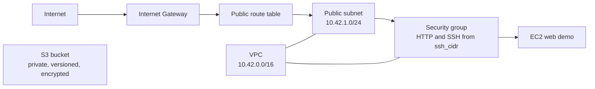

# Final Project Terraform

This is the Session 21 copy of the Session 19 AWS demo configuration. It
provisions a VPC, public subnet, Internet Gateway, route table, security group,
EC2 HTTP demo using Amazon Linux 2023 and a private S3 bucket. The S3 bucket also blocks public access,
enables versioning, and enforces SSE-S3. The main Session 19 exercise remains
in [`../../terraform-cloud/`](../../terraform-cloud/).

## Architecture



## Inputs

Copy `terraform.tfvars.example` to `terraform.tfvars` and replace the example
AMI ID, globally unique bucket name, and `ssh_cidr` with values valid for your
region and network. The sample documentation CIDR does not permit real access.
`terraform.tfvars` is ignored by Git. Provide AWS credentials through a secure
AWS profile or environment configuration, never through Terraform variables.

## Local Validation

```bash
terraform fmt -check -recursive
terraform validate
```

Both passed locally with Terraform 1.16.5 and AWS provider 5.100.0. Validation
does not create cloud resources.

## Cloud Workflow (Applied, Verified and Destroyed)

```bash
terraform init
terraform fmt -recursive
terraform validate
terraform plan -out=tfplan
terraform apply tfplan
terraform show
terraform output
terraform destroy
```

This project's own authenticated Sydney plan passed on 21 October 2026 (IST):
**11 to add, 0 to change, 0 to destroy**. [Actual plan](../../evidence/aws-plans/final-plan.txt).
The reviewed plan was separately applied; healthy EC2 status, the real HTTP page
and S3 controls were checked; show/output and destroy passed. The instance is
terminated and its VPC/root disk/bucket are absent. [Execution proof](../../evidence/aws-execution/README.md). The default region is `ap-southeast-2`, and the provider rejects
accounts other than `525426877661`. See the [credential workflow, exact plans,
cost estimate and cleanup scope](../../AWS-HOMEWORK.md). RelayDesk's separate EKS
deployment is not evidence that this project's Terraform was applied.
