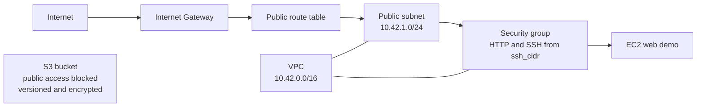

# Terraform Cloud Demo — Session 19

This project describes an AWS VPC, public subnet, Internet Gateway, default
route, restricted web security group, EC2 HTTP demo, and private S3 bucket.
The S3 bucket blocks public access, enables versioning, and enforces SSE-S3.

## Architecture



The EC2 instance uses an Amazon Linux 2023 AMI and installs Apache with `user_data`.
The `ssh_cidr` input restricts both HTTP and SSH ingress to the supplied CIDR;
the example value is from a documentation-only address range and must be
replaced before any real deployment. Amazon Linux 2 reached end of life on
30 June 2026, so this example uses Amazon Linux 2023 ([AWS release notes](https://docs.aws.amazon.com/AL2/latest/relnotes/relnotes-20260825.html),
[AL2023 support lifecycle](https://docs.aws.amazon.com/linux/al2023/ug/release-cadence.html)). The user data installs Apache with AL2023's
[DNF package manager](https://docs.aws.amazon.com/linux/al2023/ug/package-management.html).

## Inputs

Copy the safe example and replace the AMI ID, globally unique bucket name, and
CIDR with values valid for your own region and network:

```bash
cp terraform.tfvars.example terraform.tfvars
```

`terraform.tfvars` is ignored by Git. Do not put AWS credentials in it. Supply
credentials via an AWS profile or secure environment configuration.

## Local Validation

These checks need Terraform and the locked AWS provider plugin, but do not need
an AWS account or call AWS:

```bash
terraform fmt -check -recursive
terraform validate
```

Both passed locally with Terraform 1.16.5 and AWS provider 5.100.0.

## Cloud Workflow (Applied, Verified and Destroyed)

Once valid inputs and AWS access are available, review every plan before apply:

```bash
terraform init
terraform fmt -recursive
terraform validate
terraform plan -out=tfplan
terraform apply tfplan
terraform show
terraform output
terraform destroy
```

This project's authenticated Sydney plan passed on 21 October 2026 (IST):
**11 to add, 0 to change, 0 to destroy**. [Actual plan](../evidence/aws-plans/s19-plan.txt).
The reviewed plan was applied, its running instance and HTTP page and S3 controls
were verified, show/output captured, and destroy completed. The EC2 instance is
terminated; its VPC, root disk and bucket are absent. [Execution proof](../evidence/aws-execution/README.md). Use the [account-guarded credential workflow](../AWS-HOMEWORK.md)
for the existing `devops-new` CLI login. Providers are restricted to account
`525426877661`; the default region is `ap-southeast-2`. The example file is safe
input guidance, not populated deployment values. The required plan screenshot
remains pending because no capture surface was available. This is a homework
topology; EC2, storage, public IPv4 and transfer can incur charges.
